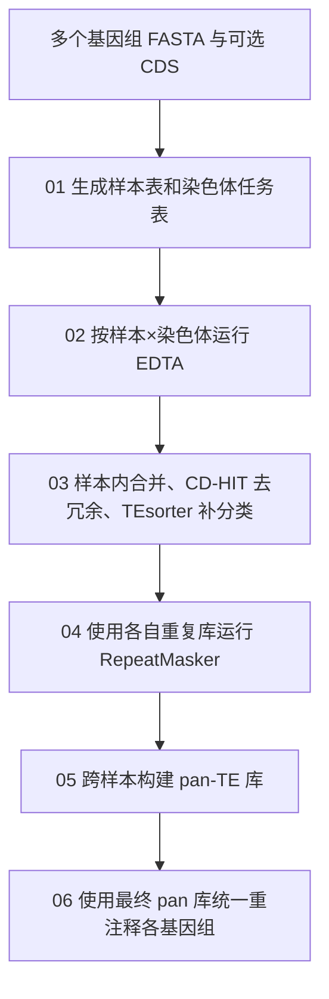

# 植物 pan-TE 构建教程

## 验证状态（2026-11-03）

当前为运行验证中版本，尚未完成服务器01–06全流程验收。本地54项回归测试及10个Shell脚本的语法检查通过；回归使用小文件与工具替身，不等同于生物学分析成功。

B端已验收新10份组装及索引、01任务表（10份样本、150项任务）；Perl/BioPerl、独立samtools和EDTA自带依赖检查已通过。LTR_FINDER入口缺少配套`bin/`导致`cut.pl`无法调用的问题已在B补链，两个辅助脚本的可读性已确认；本地可选安装脚本已固化同一修复，即使主入口已存在也检查辅助目录，重复执行不会嵌套链接。旧报错留下的仅含注释的finder候选不能作为正常零检出复用，需先停止对应作业并清理该染色体的未验收缓存。TIR-Learner 4.08使用`grf_rs`，当前无需补装旧版`grf-main`、`dask`或`swifter`。

最新服务器证据为21958_1（AJBC_GCAv2/Chr01）已清除失败缓存后重新提取序列、加载CDS并启动LTR候选检测。尚无整条染色体EDTA完成证据，03–06尚未验收；不得将本版本标为“服务器全流程已跑通”。

## B部署与当前批次

将 `edta_B.tar.gz` 上传到B项目根目录后执行：

```bash
PROJECT=/public/home/a326/luojy/project/graph_pangenome_LJ43_hap1
cd "$PROJECT"
mkdir -p "$PROJECT/scripts4TE"
tar -xzf edta_B.tar.gz --strip-components=1 -C "$PROJECT/scripts4TE"
cd "$PROJECT/scripts4TE"
mkdir -p logs
export EDTA_CONFIG="$PWD/edta_config.sh"
source "$EDTA_CONFIG"
printf 'GENOME_DIR=%s\nEDTA_OUT_DIR=%s\nTASK_TABLE=%s\nSAMTOOLS_BIN=%s\n' \
    "$GENOME_DIR" "$EDTA_OUT_DIR" "$TASK_TABLE" "$SAMTOOLS_BIN"
```

本包以本地最新版edta的01–06为执行主线；环境安装和指定失败染色体补跑仍为optional工具。主线不设置单染色体或单样本试跑阶段。上传只写入项目的 `scripts4TE/` 脚本目录，输入与结果位于项目的 `data/`、`04_panTE/`、`05_panTE_annotation/`。

新10份组装为 AJBC_GCAv2、CG、FDDB_hapA_v2、FDDB_hapB_v2、JGY_hapA、JGY_hapB、QC1、RG、YWXY、ZJ_GCAv2。服务器已验收 `data/edta_new/edta_samples.txt` 为10行、`edta_tasks.tsv` 为150行；输入和配置不变时直接复用。确认没有旧作业仍在写同一结果目录后，从02全量数组继续：

```bash
N_TASKS=$(wc -l < "$TASK_TABLE")
sbatch --array="1-${N_TASKS}%6" 02_annotate_chromosomes.sh
```

每个数组任务对应任务表一行，必须提交完整150项；并发上限6项。阶段完成后按下文验收，再推进03和04。当前21958_1已单独处理第1项；若它仍在运行，剩余项用`--array=2-150%5`提交，待其退出后用`scontrol update JobId=<剩余数组JobID> ArrayTaskThrottle=6`提高到6，避免重复提交第1项。尚未收到剩余数组的实际JobID，不能记为已提交。

当前05/06使用当前样本表，因此批次仍是这10份。原计划其余26份尚待迁移，汇总全部36份建库的输入接入将在迁移时准备；不要将当前10份的库当成36份最终库，也不要为接入既有结果直接把26份追加到当前EDTA任务表。`inputs/`保留原人工维护的新10份清单与36份组装来源表，供后续接入核对，当前01按输入目录生成任务表。

B环境：EDTA2_fix已完成Perl/BioPerl修复；samtools_env内的samtools已在EDTA环境下通过版本检查与100bp序列提取。公共激活函数在Conda初始化和切换期间暂时关闭nounset并在结束后恢复，失败仍返回非零。合并前需确认 `TESORTER_ENV` 指向可运行TEsorter的环境；当前未取得TEsorter环境配置及全量EDTA成功证据。

从多个基因组出发，依次完成 **染色体级 EDTA 建库、样本内合并与补分类、RepeatMasker 自库位置注释、跨样本 pan-TE 库构建和统一 pan-TE 库重注释**。以茶树为例，使用 EDTA、TEsorter、RepeatMasker、CD-HIT 和 MMseqs2 组合，在 Linux / Slurm 集群运行。

主流程从正式数据准备开始，不设置单染色体或单样本试跑。**所有计算作业均先进入脚本目录，再用 `sbatch` 提交；每一步完成并核对结果后再进入下一步。**

重复库保存家族代表序列；位置注释记录重复序列在基因组中的区间。库中的序列数不等于基因组中的 TE 拷贝数。

## 教程导航

- [流程与文件](#workflow)
- [运行前准备](#preparation)
- [01 生成任务表](#step01)
- [02 全量染色体建库](#step02)
- [03 样本内合并与补分类](#step03)
- [04 RepeatMasker 全基因组注释](#step04)
- [05 构建 pan-TE 库](#step05)
- [06 使用最终 pan-TE 库统一重注释](#step06)
- [作业检查与已有结果续接](#validation)
- [可选工具](#optional)
- [结果解释与已知限制](#limitations)
- [参考资料](#references)

<a id="workflow"></a>
## 流程与文件



| 步骤 | 脚本 | 任务单位 |
|---|---|---|
| 01 | [01_prepare_task_table.sh](01_prepare_task_table.sh) | 整个批次，一个作业 |
| 02 | [02_annotate_chromosomes.sh](02_annotate_chromosomes.sh) | 每个样本的一条染色体，一个数组任务 |
| 03 | [03_merge_and_classify_libraries.sh](03_merge_and_classify_libraries.sh) | 每个样本，一个数组任务 |
| 04 | [04_mask_genomes_with_repeatmasker.sh](04_mask_genomes_with_repeatmasker.sh) | 每个样本，一个数组任务 |
| 05 | [05_build_pan_te_library.sh](05_build_pan_te_library.sh) | 整个批次，一个作业 |
| 06 | [06_mask_genomes_with_pan_te.sh](06_mask_genomes_with_pan_te.sh) | 每个样本，一个数组任务 |

```text
scripts4TE/
├── README.md
├── edta_config.sh                       # 路径与环境配置
├── workflow_common.sh                   # 各阶段共用函数，不单独提交
├── 01_prepare_task_table.sh
├── 02_annotate_chromosomes.sh
├── 03_merge_and_classify_libraries.sh
├── 04_mask_genomes_with_repeatmasker.sh
├── 05_build_pan_te_library.sh
├── 06_mask_genomes_with_pan_te.sh
├── optional/
│   ├── setup_edta_environment.sh         # 已有可用环境时跳过
│   └── rerun_chromosome.sh               # 指定失败目标补跑
├── supple_summarize_te_bed.py            # 已有BED的补充统计工具
├── tests/                               # 代码回归测试，不是分析步骤
└── logs/                                # 提交前自行建立
```

<a id="preparation"></a>
## 运行前准备

### 1. 数据与软件

每个样本准备明确版本的基因组，命名为 `<sample>.chrom.fasta`。FASTA 序列名称唯一。对应 CDS 可选，命名为 `<sample>.cds.fa`，需来自该样本配套的基因注释，不能把基因组 FASTA 直接改名作为 CDS。

```text
project/
├── data/chromosome_only/
│   ├── SAMPLE_A.chrom.fasta
│   └── SAMPLE_B.chrom.fasta
├── cds/                                 # 可选
│   ├── SAMPLE_A.cds.fa
│   └── SAMPLE_B.cds.fa
├── data/edta_new/edta_tasks.tsv          # 01生成
├── data/edta_new/edta_samples.txt        # 01生成
├── data/edta_new/                  # 02–04结果
├── 04_panTE/                          # 05结果
└── 05_panTE_annotation/                  # 06统一pan库注释结果
```

01会在 `.fai` 缺失或早于 FASTA 时用 samtools 建立索引，因此输入目录需允许写入索引；原 FASTA 不改写。`GENOME_DIR` 应只放本批次参与分析的组装。任务表会纳入每份 `.fai` 的全部序列，包括未定位序列；若只分析主染色体，应提前准备只含主染色体的 FASTA。

已有环境直接复用：

| 环境 | 必需内容 |
|---|---|
| `EDTA_ENV`，默认 `EDTA2_fix` | EDTA 2.2.2、CD-HIT、MMseqs2、RepeatMasker及其依赖；samtools独立配置 |
| `TESORTER_ENV`，默认 `tesorter` | TEsorter 与 `rexdb-plant` 数据库 |
| 系统 | Bash、Python 3、Slurm 和 GNU 常用工具 |

环境安装不是正式主线；缺少 EDTA 环境时见[可选工具](#optional)。TEsorter 环境需预先按[官方安装说明](https://github.com/zhangrengang/TEsorter#installation)准备，现有 EDTA 安装脚本不创建它。

### 2. 修改配置

编辑 [edta_config.sh](edta_config.sh)，将案例路径换成自己的实际路径：

| 配置 | 含义 |
|---|---|
| `PROJDIR` | 输入和结果所在的项目根目录 |
| `GENOME_DIR` | 本批次 `<sample>.chrom.fasta` 所在目录 |
| `CDS_DIR` | 可选 CDS 所在目录 |
| `EDTA_OUT_DIR` | 染色体库、样本库及 self RepeatMasker 结果 |
| `PANTE_DIR` | pan-TE 库与构建工作目录 |
| `PANTE_MASK_DIR` | 06统一pan库注释目录，默认 `$PROJDIR/05_panTE_annotation` |
| `TASK_TABLE` | 样本—染色体任务表 |
| `SAMPLE_TABLE` | 样本表 |
| `CONDA_SH` | B为 `/public/home/a326/luojy/miniconda3/etc/profile.d/conda.sh` |
| `SAMTOOLS_BIN` | B为 `/public/home/a326/luojy/miniconda3/envs/samtools_env/bin/samtools`，用于索引和染色体提取 |
| `EDTA_ENV`、`TESORTER_ENV` | 实际环境名称或路径 |

B版使用 `data/edta_new`、`04_panTE`，与已部署的数据位置一致。任务表位于 `data/edta_new/`。配置支持同名环境变量覆盖；使用新终端或确认没有遗留的覆盖值，再加载本次配置。

B版作业默认 `--partition=core128 --account=a326 --qos=normal`；CPU、内存和时限沿用本地主线参数，其他分区可在提交时用 `--partition` 覆盖。修改 CPU 时同时核对脚本内线程数；RepeatMasker 的 `-pa` 是并行任务数，不直接等于 Slurm CPU 数。

### 3. 固定提交位置

以下命令中的路径替换为**服务器上的脚本目录**：

```bash
cd /public/home/a326/luojy/project/graph_pangenome_LJ43_hap1/scripts4TE
mkdir -p logs
source edta_config.sh
```

`source` 只加载路径变量，用于读取任务表行数，不执行分析。所有后续 `sbatch` 命令从这里运行；日志写入当前脚本目录的 `logs/`。Slurm 中通过 `SLURM_SUBMIT_DIR` 找到公共函数和默认配置，脚本、配置及输入需对计算节点可见。

重开终端后重新执行这三行。若使用自定义配置，在该目录设置 `export EDTA_CONFIG=/absolute/path/config.sh`，并加载同一份配置；各阶段保持一致。

<a id="step01"></a>
## 01｜生成任务表

**做什么。** 扫描 `GENOME_DIR/*.chrom.fasta`，为每份组装准备匹配索引，生成固定的样本表和染色体任务表。

```bash
sbatch 01_prepare_task_table.sh
```

等待01完成，再查看：

```bash
head "$SAMPLE_TABLE"
head "$TASK_TABLE"
wc -l "$SAMPLE_TABLE" "$TASK_TABLE"
```

产物格式：

| 文件 | 格式 | 顺序 |
|---|---|---|
| `edta_samples.txt` | 无表头，每行一个样本ID | 按样本文件名排序 |
| `edta_tasks.tsv` | 无表头，Tab分隔的 `sample`、`chromosome` 两列 | 先样本，再按该样本 `.fai` 的行序 |

任务表例子：

```text
SAMPLE_A	Chr01
SAMPLE_A	Chr02
SAMPLE_B	Chr01
```

这里展示的 `\t` 表示Tab，实际由脚本写入。**数组任务号就是对应表的行号**，不再固定样本数或每份组装的染色体数。核对材料范围和任务数量后，02–06期间不要修改任务表或更换输入。仅文件内容相同时，重复01会保留现有任务表时间。

<a id="step02"></a>
## 02｜全量染色体建库

**做什么。** 每个数组任务从对应样本提取一条序列，运行 EDTA，保存该染色体重复库。

确认01完成后，在同一目录提交：

```bash
N_TASKS=$(wc -l < "$TASK_TABLE")
sbatch --array="1-${N_TASKS}%6" 02_annotate_chromosomes.sh
```

`%6` 表示最多同时运行6个染色体任务，按配额与I/O能力调整；数组范围必须覆盖整个任务表。数组脚本头部默认任务号为1，直接省略 `--array` 只会处理第1行，不能作为全量提交。

沿用的 EDTA 参数为 `--species others --step all --anno 0 --sensitive 0 --force 1 --threads 16`。有 CDS 文件时追加 `--cds`。

| 参数 | 本流程中的含义 |
|---|---|
| `--anno 0` | 此步建库，不进行完整基因组的TE位置注释 |
| `--sensitive 0` | 不启用额外的 RepeatModeler 敏感搜索 |
| `--force 1` | 沿用 EDTA 2.2.2 的候选缺失回退策略，不是强制重新计算开关；解释见[已知限制](#limitations) |

输出位于：

```text
data/edta_new/<sample>/per_chr/<chr>/
├── <chr>.fa.mod.EDTA.TElib.fa
├── edta_<chr>.log
└── edta.complete
```

**何时继续。** 所有预期染色体任务均正常退出，最终库非空，且有有效的 `edta.complete`。标记第一行为 `complete`，第二行为当次实际使用的 CDS 完整路径或 `none`。已完成且输入未变化的染色体会跳过；只有非空库而没有有效标记时会停止，需检查来源。作业末尾沿用原脚本的部分大型中间文件清理。

<a id="step03"></a>
## 03｜样本内合并与补分类

**做什么。** 按每份基因组的 `.fai` 汇总全部染色体库，去冗余，再为部分未分类 LTR 补充分类。

02全部完成并核对后：

```bash
N_SAMPLES=$(wc -l < "$SAMPLE_TABLE")
sbatch --array="1-${N_SAMPLES}%4" 03_merge_and_classify_libraries.sh
```

| 部分 | 方法 | 输出 |
|---|---|---|
| 合并与去冗余 | 为ID增加染色体前缀；CD-HIT `-c 0.8 -G 1 -aS 0.8 -aL 0.8` | `<sample>_TElib_nr.fa` |
| LTR补分类 | 提取 `LTR/unknown`，忽略大小写；TEsorter `-db rexdb-plant`，只回填 Gypsy/Copia | `<sample>_TElib_nr.reclassified.fa` |

输出在 `data/edta_new/<sample>/merged/`；两个部分分别生成 `nr.complete`、`reclass.complete`。TEsorter中间文件在该样本的 `tesorter_reclass/`。

**何时继续。** 所有样本任务正常完成，CD-HIT去冗余与TEsorter运行成功，最终 `.reclassified.fa` 非空，标记与当前上游一致。补分类只改相应标签，序列数应与去冗余库一致。单独标记为 `Unknown` 的序列保留原标签，不强行分类；没有待补分类LTR时，复制原库到统一的 `.reclassified.fa` 路径。

<a id="step04"></a>
## 04｜RepeatMasker 全基因组注释

**做什么。** 每份基因组使用自己的 `.reclassified.fa`，定位重复序列并生成软屏蔽基因组。

03全部完成并核对后：

```bash
N_SAMPLES=$(wc -l < "$SAMPLE_TABLE")
sbatch --array="1-${N_SAMPLES}%8" 04_mask_genomes_with_repeatmasker.sh
```

当前核心参数为 `-pa 4 -lib <样本库> -gff -no_is -nolow -xsmall`，作业申请16 CPU。`-xsmall` 用小写标记屏蔽区域；`-nolow` 不额外屏蔽简单重复与低复杂度序列。

输出：

```text
data/edta_new/<sample>/repeatmasker_self/
├── <sample>.chrom.fasta.out          # 重复序列位置
├── <sample>.chrom.fasta.out.gff      # GFF注释
├── <sample>.chrom.fasta.tbl          # 汇总统计
├── <sample>.chrom.fasta.masked       # 软屏蔽序列
├── repeatmasker.log
└── repeatmasker.complete
```

**何时继续。** 所有样本正常退出、输出通过检查且有 `repeatmasker.complete`。脚本检查软屏蔽FASTA的序列名与长度是否和输入一致；工具失败或产物截断时不发布新结果。

合法零命中时，`.out` 可能只有一条无重复序列提示，不生成常规 `.tbl` 和GFF；若未生成 `.masked`，脚本复制原始基因组作为零命中时等价的软屏蔽结果。旧的正式结果在失败重跑中保留，新结果通过检查后才替换。

<a id="step05"></a>
## 05｜构建 pan-TE 库

**做什么。** 读取与02–04相同的样本表，汇总各样本重复库及self RepeatMasker位置注释，生成跨样本的pan-TE代表序列库。

04全部完成并核对后：

```bash
sbatch 05_build_pan_te_library.sh
```

脚本先检查全部样本的基因组、重分类库、`.out`与完成记录，再选择可用的建库路径：

| 路径 | 条件 | 实际处理 |
|---|---|---|
| panEDTA复用 | 能找到panEDTA，至少有一份非空CDS，且复用及建库检查通过 | 按EDTA命名放置已有库与`.out`，使用 `panEDTA.sh -a 0` 仅建pan库 |
| 自定义合并 | 没有CDS、panEDTA不可用、复用检查或建库失败等 | 合并样本库，CD-HIT 80%，再用MMseqs2 90%和80%聚类 |

两条路径共用最终文件名：

```text
04_panTE/
├── Tea_panTE.lib.fasta
└── panEDTA_work/
    └── run.XXXXXX/                  # 每轮独立工作目录，实际路径见日志
```

**验收要点。** 作业 `COMPLETED / 0:0`，最终库非空、含有效FASTA记录，并从日志确认本轮实际采用的路径：

- panEDTA路径：退出码为0；`Existing EDTA annotation found` 的次数与样本数一致；没有 `De novo annotate`。这些检查在工具返回后执行。
- 自定义路径：本轮 `cdhit_pan.log`、`linclust.log`、`cluster.log` 对应命令均成功，代表序列输出有效。

panEDTA复用依赖EDTA 2.2.2的命名与脚本布局；本轮生成临时的 `panEDTA.checked.sh` 传播建库步骤的错误，不修改已安装的软件。使用首份可用CDS作为 `-c` 参数，不代表每份样本都接受其自身CDS过滤。回退聚类是不同方法，记录结果时须保留实际分支。

05只生成最终pan库；完成验收后继续06。04的self注释用于建库，06另用最终pan库统一注释，输出目录独立。

<a id="step06"></a>
## 06｜使用最终 pan-TE 库统一重注释

**做什么。** 使用同一个 `$PANTE_DIR/Tea_panTE.lib.fasta`，对 `$SAMPLE_TABLE` 中的每份组装运行RepeatMasker。样本表沿用01生成的无表头清单；任务数由其行数决定，适用于任意批次，不固定组装数。

先验收05，并确认01–05使用的基因组、样本表和最终pan库已经定稿。在脚本目录、加载同一配置后提交：

```bash
N_SAMPLES=$(wc -l < "$SAMPLE_TABLE")
JOB_PAN_RM=$(sbatch --parsable --array="1-${N_SAMPLES}%4" \
    06_mask_genomes_with_pan_te.sh)
echo "$JOB_PAN_RM"
```

数组任务号对应样本表行号。`%4` 表示最多同时处理4份组装，可按配额调整。脚本头部默认数组任务为1，省略 `--array` 只会处理第一份。每任务沿用04的16 CPU、100G内存、120小时以及 `-pa 4 -gff -no_is -nolow -xsmall` 参数；唯一使用的重复库是05最终pan库。这里的 `-pa 4` 是RepeatMasker并行任务数。

默认产物：

```text
05_panTE_annotation/
└── SAMPLE_A/
    ├── SAMPLE_A.chrom.fasta.out         # 统一库匹配坐标
    ├── SAMPLE_A.chrom.fasta.out.gff
    ├── SAMPLE_A.chrom.fasta.tbl
    ├── SAMPLE_A.chrom.fasta.masked      # 软屏蔽基因组
    ├── repeatmasker.log
    ├── repeatmasker.inputs.json         # 输入路径、大小、修改时间和参数
    └── repeatmasker.complete            # 本次计算与产物检查通过后写入
```

合法零命中时，`.out` 为无重复序列提示，可能没有`.tbl/.out.gff`；未生成`.masked`时复制原基因组作为等价软屏蔽结果。

**验收。** 等待所有数组子任务结束，核对每项为 `COMPLETED / 0:0`，同时检查 `logs/rm_panTE_<数组JobID>_<任务号>.out/.err`、各组装的 `repeatmasker.log` 和上述产物：

```bash
sacct -j "$JOB_PAN_RM" --format=JobID,State%20,ExitCode,Elapsed,MaxRSS
while IFS= read -r sample; do
    result="$PANTE_MASK_DIR/$sample"
    if [ -s "$result/repeatmasker.complete" ] &&
       [ -s "$result/repeatmasker.inputs.json" ] &&
       [ -s "$result/$sample.chrom.fasta.out" ] &&
       [ -s "$result/$sample.chrom.fasta.masked" ]; then
        echo "产物齐全: $sample"
    else
        echo "缺少产物: $sample"
    fi
done < "$SAMPLE_TABLE"
```

上面的文件清点需结合本轮Slurm状态和日志判断。脚本发布结果前检查RepeatMasker与日志管道退出码、常规/零命中产物，以及软屏蔽FASTA的名称、顺序和忽略大小写后的碱基一致性。运行期间基因组或pan库变化会拒绝发布。检查读取大FASTA，在计算节点随作业执行。

已有完整且输入记录匹配的结果会跳过；失败重跑保留原正式目录，本次日志留在相邻`.run.*`目录。只补跑失败序号，例如：

```bash
sbatch --array=2,7 06_mask_genomes_with_pan_te.sh
```

将 `2,7` 换成实际失败的样本表行号。**最终pan库更新后，应对全部样本重新提交06并验收**；脚本会根据输入记录重跑需要更新的结果。06不覆盖04的self注释。

主流程到06结束。统一库注释提供各组装上的家族匹配坐标，后续跨组装同源插入位点、TE PAV和独立完整拷贝的判定仍需单独分析。

<a id="validation"></a>
## 作业检查与已有结果续接

`sbatch` 返回的任务号用于查看状态。将下面数字换成实际JobID：

```bash
JOBID=12345
sacct -j "$JOBID" --format=JobID,State%20,ExitCode,Elapsed,MaxRSS
```

同时查看 `logs/` 中对应的 `.out`、`.err` 和上面列出的实际产物。数组任务须逐项完成，不能只看数组父任务。默认日志名：

| 阶段 | 日志前缀 |
|---|---|
| 01 | `edta_tasks_<JobID>` |
| 02 | `edta_v2_<数组JobID>_<任务号>` |
| 03 | `merge_reclass_<数组JobID>_<任务号>` |
| 04 | `rm_per_sample_<数组JobID>_<任务号>` |
| 05 | `panEDTA_final_<JobID>` |
| 06 | `rm_panTE_<数组JobID>_<任务号>` |

已有完成结果时从需要的阶段接续，保留同一数据目录与任务表，不必重新运行上游。输入、索引、CDS来源或上游库变化会影响后续复用判定；旧结果只有非空文件而无匹配完成证据时，不要直接补写标记。先核对当次日志、作业状态和输入来源，再决定复用或补跑。

普通失败数组可按原行号重投，例如只提交第7、12个染色体任务：

```bash
sbatch --array=7,12 02_annotate_chromosomes.sh
```

若目标已有损坏库或raw缓存，使用下面的指定目标补跑工具；不批量删除其他已完成结果。

<a id="optional"></a>
## 可选工具

### EDTA环境安装

已有可用环境时跳过。需要新建环境时，在同一脚本目录执行：

```bash
sbatch optional/setup_edta_environment.sh
```

计算节点需要访问Conda软件源。脚本创建Python 3.10、EDTA 2.2.2及相关依赖，检查BioPerl和LTR工具路径；已有同名环境时也会进入修复与检查，不要在使用该环境的作业运行期间执行。

查看 `~/EDTA2_fix_validation.txt`，源码备份位于 `~/EDTA2_fix_pristine_backup/`。TEsorter环境需单独准备，见前面的环境表。

### 指定染色体补跑

确认旧目标作业已停止，保存需要保留的旧库与日志后：

```bash
sbatch --export=ALL,RERUN_SAMPLE=SAMPLE_A,RERUN_CHR=Chr01 \
    optional/rerun_chromosome.sh
```

把样本和染色体改成实际目标。该脚本会删除目标的EDTA raw缓存和已有TElib，再原位重建。成功后依次重新提交受影响样本的03、04，再按需要重建05；05最终库更新后，重新提交全部样本的06。使用原样本表行号。

### 已有BED统计

[supple_summarize_te_bed.py](supple_summarize_te_bed.py) 是独立补充工具，读取已有BED与FASTA索引，统计类别记录数、区间长度之和及其占基因组长度的比例，不参与01–06。

BED至少四列、Tab分隔、无表头，坐标为0-based半开区间；第4列为类别或 `class|ID`。该脚本不合并重叠区间，输出不能直接当作非冗余覆盖率或独立TE拷贝数。本目录不包含RepeatMasker到此BED格式的转换。

<a id="limitations"></a>
## 结果解释与已知限制

- 02沿用 `--force 1`。在EDTA 2.2.2中，某些raw候选缺失时可能使用内置水稻TE序列继续；这不是强制重跑参数。实际是否触发应查日志，不能未经核查就把最终库全部解释为本样本从头发现。
- `Unknown` 表示分类信息不足；TEsorter补分类不等于实验功能证明，也不能单凭分类更完整判断库质量提高。
- panEDTA与自定义聚类采用不同的代表序列筛选方式，不能混称同一方法；聚类阈值影响家族粒度。库条目数不直接等于生物学家族多样性。
- 本流程生成重复序列资源，不执行蛋白编码基因预测、TE插入多态性或群体差异检验。原组装版本、材料范围和坐标系统需随结果记录。
- 01–05沿用已有分析参数及结果目录；06新增统一pan库注释，结果独立保存。`tests/` 是开发用小文件/工具替身回归测试，不要求用户作为生信分析阶段运行；不代替整理后服务器提交方式的实际验收。

<a id="references"></a>
## 参考资料

- [EDTA 2.2.2及panEDTA](https://github.com/oushujun/EDTA/tree/v2.2.2)：重复序列发现与跨样本建库。
- [TEsorter](https://github.com/zhangrengang/TEsorter)：蛋白结构域辅助分类。
- [RepeatMasker参数手册](https://github.com/Dfam-consortium/RepeatMasker/blob/master/repeatmasker.help)：位置注释及软屏蔽。
- [CD-HIT](https://github.com/weizhongli/cdhit)、[MMseqs2](https://github.com/soedinglab/MMseqs2)：序列去冗余与聚类。

用于论文时，记录实际软件和数据库版本、参数、组装版本及采用的建库分支，并引用对应工具论文。
